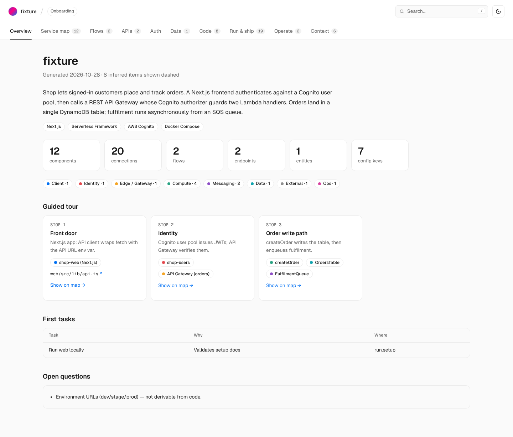
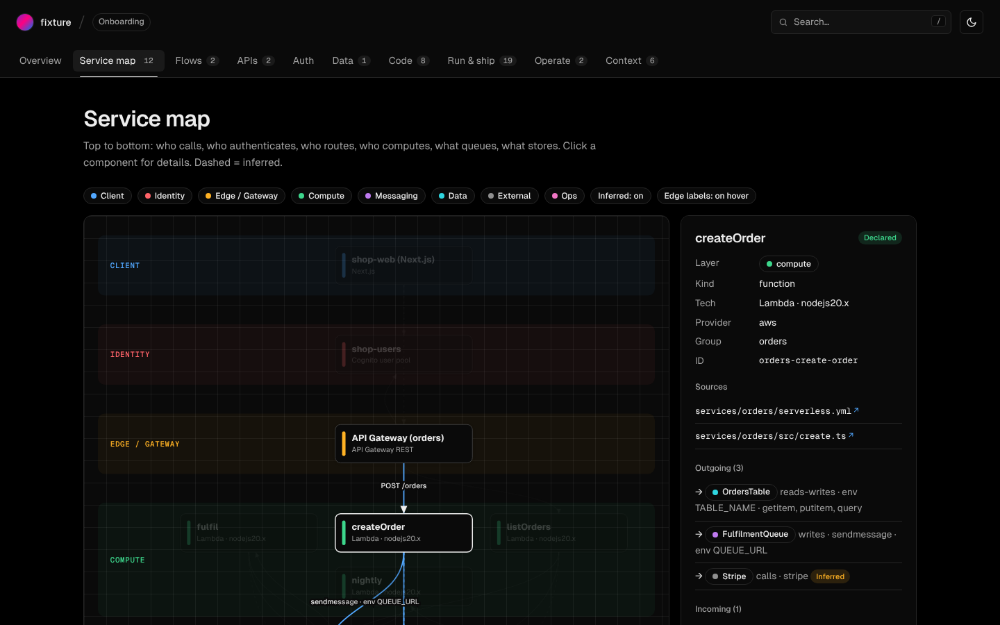

# codebase-onboarding

A Claude skill that turns any codebase into an interactive onboarding map: services, auth, request flows, data, APIs and setup, in one offline HTML page.

New to a project? Ask Claude *"I'm new to this repo. Map how it fits together."* and get `docs/onboarding/atlas.html`: a page you can open in any browser, commit, and share with the next new teammate.



## What you get

| Tab | Answers |
|---|---|
| **Overview** | What is this system? Where do I start? (guided tour, open questions) |
| **Service map** | How do frontend → auth → gateway → compute → queues → data connect? |
| **Flows** | What happens, step by step, when a user logs in or places an order? |
| **APIs** | Which endpoints exist, who handles them, what auth they need |
| **Auth** | Identity provider, tokens, where they're verified, roles |
| **Data** | Entities, keys, access patterns, owning service |
| **Code** | Entry points and modules |
| **Run & ship** | Local setup, environments, config keys (names only), CI/CD |
| **Operate** | Logs, alarms, symptom → check → fix runbooks |
| **Context** | Glossary, owners, decisions, hotspots |

Every component and connection is marked **declared** (found in config or code) or **inferred** (Claude's reasoned guess, drawn dashed). Anything the repo can't answer becomes an open question instead of a made-up fact.



## Works with

AWS (Serverless Framework, SAM, CloudFormation, CDK, Terraform), Azure, GCP, Docker Compose, Kubernetes, OpenAPI, Prisma, Next.js, React, Vue, Angular, Express, NestJS, Django, FastAPI, Flask, Cognito, Entra ID, Auth0, Clerk, NextAuth, and more. Unknown stacks still work: the scanner finds less, and Claude reads more.

## Install

### Claude Code (recommended)

```
/plugin marketplace add Shuashuaa/codebase-onboarding
/plugin install codebase-onboarding@codebase-onboarding
```

Updates arrive through `/plugin`.

### Claude Code (manual)

Download `codebase-onboarding.skill` from [Releases](../../releases) (it's a zip), then extract it:

```bash
# macOS / Linux
mkdir -p ~/.claude/skills && unzip codebase-onboarding.skill -d ~/.claude/skills/
```

```powershell
# Windows PowerShell
New-Item -ItemType Directory -Force "$env:USERPROFILE\.claude\skills" | Out-Null
tar -xf .\codebase-onboarding.skill -C "$env:USERPROFILE\.claude\skills"
```

To share it with a team, extract it into the project's `.claude/skills/` folder instead and commit it.

### Claude app (web / desktop)

Upload `codebase-onboarding.skill` from [Releases](../../releases) in the app's skill settings.

## Use

Open Claude Code in the repo you want to understand and ask in plain words:

- "I'm new to this repo. Map how it fits together."
- "Draw the service map."
- "Where does auth happen? Trace a request end to end."

Output lands in `docs/onboarding/` (`atlas.json` is the source, `atlas.html` the page). Run it again later and Claude updates the existing atlas rather than starting over.

By default Claude **reads** the code and never runs it (no installs, tests or builds), so a small repo maps in a few minutes. Ask for **"deep mode"** if you want the setup steps actually run and marked as verified.

### Scripts on their own

Requires Python 3.8+. PyYAML is optional but recommended. Scripts live in `plugins/codebase-onboarding/skills/codebase-onboarding/scripts/`.

```bash
python3 scripts/scan.py <repo>                          # draft docs/onboarding/atlas.json
python3 scripts/merge.py <atlas.json> <patch.json>      # apply enrichment
python3 scripts/render.py <atlas.json>                  # build atlas.html
```

On Windows, use `py` in place of `python3`.

## Privacy

Everything runs locally. The generated page makes no network requests. Environment variable **names** are recorded; values never are.

## License

MIT, see [LICENSE](LICENSE). The bundled Geist and Geist Mono fonts are © Vercel and licensed under the [SIL Open Font License 1.1](plugins/codebase-onboarding/skills/codebase-onboarding/assets/fonts/OFL.txt).
